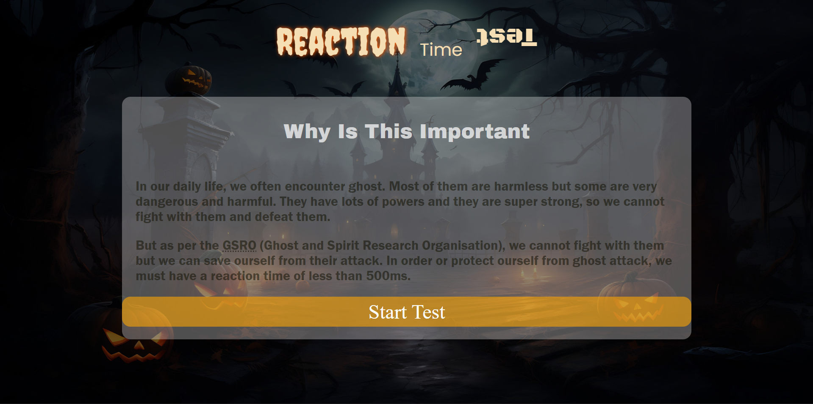
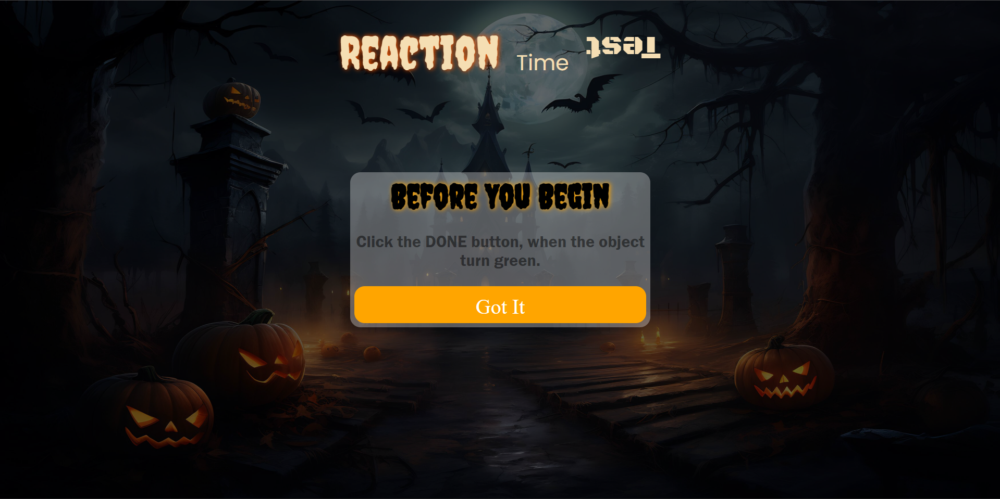
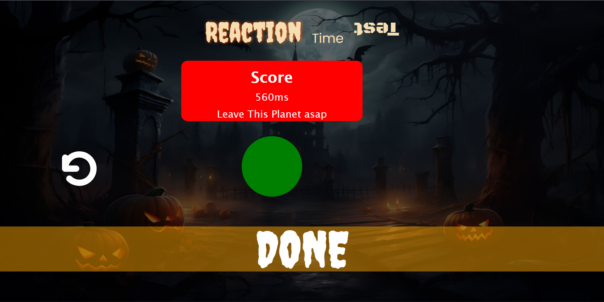

# Reaction Time Test

## Screenshot

 
 
 
 

## About 

This is a reaction time checker. It is a dark themed + spooky. I have horror background and spooky fonts as well. The reaction time checker is very important in our daily life because we often encounters ghost, so in order to save our ourself from them, then we need to avoid their attac. For that, we must have reaction time less than 500ms. If you don't have reaction time < 500ms, then either train yourself or leave this planet asap.

## Challenges

There are two challenges that I have faced. First is while building the reaction time test logic, the main problem while building was the debugging. It was not easy to debug it. I finally used lots of console.log() to debug the problem. Then found that I had placed started = true in setInterval, which was supposed to be in setTimeout.

The second challenge was while building the retry logic, it was not in the plan. But later I realise that it will be good, so that people can take test multiple times without refreshing. The challenge in this was to reset the variables and value of some element like counter. The main problem that I had faced while building the retry part was that I had reset the variables but forgot to reset the counting numbers. Therefore, in retry, the counting was like 4 ... 1..2..3. It really took me half an hour, to find this fault. But unfortunately, i cannot log this effort.

## Features

It don't have much features, it just have a spooky message in home page. Then a reaction time checker and a restart button. The last two features was really hard to build.

## Tech Stack

I have used only HTML, CSS and JS.

## Assets

- Bg Image: https://wallpapercave.com/wp/EPyuR6y.jpg
- Fonts: Google Fonts

## To Try It

Click Here, [Reaction Time Checker](https://reaction-time-theta.vercel.app/)
